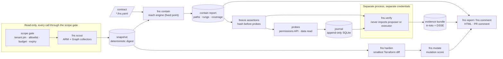

# Fang & Scale

**Unit tests for breach blast radius in Microsoft Entra and Azure.**

Declare what a compromised workload or agent identity must never reach and what it
must still do. Fang & Scale finds every path to the boundary, proposes the smallest
fix, proves the result with signed evidence, and fails CI if it regresses.

*Challenge the defence. Reduce the damage. Prove the improvement.*

```yaml
# contracts/examples/billing-agent.fns.yaml (shortened)
version: 2
assume_compromised: sp:sp-billing-agent
must_not_reach:
  - resource: kv-crown-jewels
    operations: [secrets/get, secrets/list]
  - directory: tenant
    operations: [roleAssignments/write, applications/credentials/update]
  - application: id-verifier
    operations: [credentials/update, owners/update]
must_still_do:
  - resource: st-invoices
    operations: [blob/read, blob/write]
budget:
  max_critical_reachable: 0
```

> **Status.** M1 is done and ran live. M2 to M5 are built and tested offline, against
> a recorded lab run and hand-written fixtures. Their live runs are waiting on the
> runbooks in `docs/runbooks/`. See [Real vs. fixture](#real-vs-fixture) before you
> trust any result.

## 90-second demo (no tenant)

Requires [uv](https://docs.astral.sh/uv/) and a clone of this repository. The
demo commands replay `fixtures/lab-run-1`, the live lab run recorded in M1 and
sanitized. Every line they print starts with `FIXTURE`, and none of them makes a
network call.

```
uv sync
uv run fns demo contain      # 1. What can a compromised billing agent reach?
uv run fns demo prove        # 2. Freeze assertions, replay probes, verify in a separate process
uv run fns demo mutate       # 3. Harden the lab in the model, then try to break the contract
uv run fns demo report       # 4. One HTML page: .fns/report.FIXTURE.html
```

**1. Contain.** The seeded lab contract fails on purpose (exit 1): 11 critical
findings. The agent's owner rights on another application lead to directory-wide
role assignment (output shortened):

```
FIXTURE FAIL directory:tenant roleAssignments/write  modeled / modeled-only
FIXTURE   1. [assume-compromised] assume sp-billing-agent is compromised
FIXTURE   2. [snapshot] sp-billing-agent holds the Graph permission Application.ReadWrite.OwnedBy
FIXTURE   3. [owner-adds-credential] sp-billing-agent owns app-escalation-target; with
FIXTURE      Application.ReadWrite.OwnedBy it adds a credential and signs in as app-escalation-target
FIXTURE   4. [snapshot] app-escalation-target holds the Graph permission AppRoleAssignment.ReadWrite.All
FIXTURE   5. [approle-self-grant] ... grants app-escalation-target RoleManagement.ReadWrite.Directory
FIXTURE   6. [graph-permission] RoleManagement.ReadWrite.Directory allows roleAssignments/write ...
```

**2. Prove.** Assertions are frozen and hashed before any probe runs. The verifier
then runs as a separate process that reads only those assertions and the journal.
It judges each path and signs an in-toto statement in a DSSE envelope. The demo
uses an offline key, and the output labels it `TEST SIGNATURE`. Run
`uv run fns verify .fns/runs/<run id>` to check a run; tampering exits 5.

**3. Harden and mutate.** `fns harden` finds the smallest Terraform removal that
takes the lab to 0 critical findings while keeping legitimate use: drop the agent's
`Application.ReadWrite.OwnedBy` and its resource-group `Contributor`. Mutation
testing then puts back one dangerous grant at a time. **Mutation testing found a
gap in our own contract:** the first run caught 5 of 8, because contract version 1
could not name one application. Version 2 can, and the seeded contract now guards
the verifier and scout applications and the invoice account's keys. It catches 6
of 8. The two survivors make the agent an owner of `id-verifier` or `sp-fns-scout`.
In the hardened lab the agent holds no Graph permission that can use an ownership,
so the model gains no reach, and the output says exactly that
(`docs/FINDINGS.md`).

**4. Report.** Coverage comes first, then the reach graph, findings and paths, the
proof bundle and the mutation results. It is one self-contained HTML file with
Cytoscape.js embedded (MIT, `src/fns/report/vendor/`), so it opens offline and
makes no network request.

Other commands: `fns harden`, `fns record` (turns logs into `must_still_do`),
`fns detections check|export` (KQL rules as code), `fns comment`, and
`fns scope check`. Run `uv run fns --help` for the full list.

## Architecture



Two import contracts enforce the boundaries. `fns.verify` imports nothing from
the reach engine, probes, prover, harden, adapters or scope. The reach engine
cannot import adapters, credentials, the journal, strike or harden.

## Evidence ladder

Every finding carries the highest rung it reached and a coverage state. Semantics
the model does not support give `inconclusive`, never `pass`. A missing path is
not proof of absence either: a `must_not_reach` item passes only with an observed
denial, every path refuted, and no open surfaces.

| Rung | Means | Produced by | Status |
| --- | --- | --- | --- |
| 1 modeled | the reach model says so, from a snapshot | `fns contain` | built; live scout ran in M1 |
| 2 evaluated | Azure's own permission evaluation agrees | `fns prove` (ARM permissions probe) | built; probes replayed from hand-written results |
| 3 observed | a live, non-destructive probe saw it | `fns prove` (data-read probe) | interface only; live probes need approval (M3 P5) |
| 4 logged | the probe also shows up in the logs | detections (M4 K4) | rules written; never run in a workspace |

Coverage states: `verified`, `evaluated-only`, `modeled-only`, `not-assessed`,
`out-of-scope`. Reports lead with coverage, not a risk score.

## Real vs. fixture

| What | Evidence so far |
| --- | --- |
| Scout (RBAC, Graph, owners, roles) | **Live** on the lab tenant, 2026-11-26. Recorded and sanitized as `fixtures/lab-run-1`. |
| Key Vault and storage settings collectors (M2 C1) | Mocked tests only. Live run: `docs/runbooks/m2-live-run.md`. |
| Reach engine and contracts | Run on the live-recorded snapshot. Results are rung 1 (modeled). |
| Prove: probe results | **Hand-written** (`probes.json`), shaped like expected lab answers. Not recorded. |
| Signing | Offline test key, labelled `TEST`. The Sigstore path is written but has never run. |
| Harden, mutate | Model only, on the recorded snapshot and `lab/*.tf`. Nothing applied. |
| Record mode | Hand-written sample logs. |
| Detections | Structural lint only; never deployed. |
| GitHub Action | Runs on this repo's PRs against `fixtures/lab-run-1`; no Azure login. |

Anything replayed from a fixture prints `FIXTURE`, and reports built from one say
so in the title.

## Safety

- **Read-only by default.** Only `strike` and `harden --apply` may ever write, only
  to the lab, and only after `--approve <plan-hash>`. Neither is built:
  `harden --apply` refuses.
- **Scope gate.** Every Azure and Graph request, page and retry goes through
  `fns.scope.gate`. Anything missing, expired or mismatched is denied. The gate is
  fuzzed with Hypothesis.
- **Tenant pinning.** A run stops (exit 4) if the token's tenant differs from the
  scope manifest.
- **No secrets.** Sign-in goes through the Azure CLI or OIDC. Fixtures use
  placeholder GUIDs, and a test scans them.
- **Untrusted input.** Tenant names and texts are escaped in the HTML report and
  in the PR comment.

Exit codes: 0 within budget, 1 contract failed, 2 usage or invalid input,
3 inconclusive over budget, 4 scope denied, 5 evidence invalid. Exit 1 also
means that the check a command runs has failed:

- survivors over `--max-survivors` in `fns mutate`;
- no proposal in `fns harden`;
- a conflict in `fns record`;
- problems found by `fns detections check`;
- drift found by `fns schema --check`.

A missing or invalid contract, scope, snapshot, report or log file exits 2, and
so does an internal error, so a crash never looks like a verdict.

## Roadmap

| Milestone | Scope | State |
| --- | --- | --- |
| M1 Lab + contracts | Terraform lab, scope gate, scout, schemas | done, live |
| M2 Contain | reach engine, escalation rules, settings collectors | built; live run pending (`docs/runbooks/m2-live-run.md`) |
| M3 Prove | freeze, probes, isolated verifier, signed bundle | built offline; live probes and Sigstore pending approval |
| M4 Harden + detect | minimizer, record mode, KQL rules | built offline; live loop pending approval |
| M5 Mutation + CI | mutation score, HTML report, GitHub Action, README | built; v0.1 tag pending |
| M6 Strike + agents | non-destructive strikes, Agent ID, MCP server | not started |

Design: `docs/PLAN.md`. Milestone specs: `docs/milestones/`. Every non-trivial
choice: `docs/DECISIONS.md`. Places where Microsoft APIs behave differently from
their documentation: `docs/FINDINGS.md`.

## Lab and live runs

`lab/` is a Terraform lab (azurerm + azuread) for a **dedicated lab tenant**. It
contains:

- an over-privileged `sp-billing-agent`;
- a Key Vault and storage holding synthetic data;
- a privileged `app-escalation-target` owned by the agent;
- a read-only `id-verifier` and a read-only `sp-fns-scout`.

`uv run poe lab-up` applies it and writes `scope.lab.yaml` (gitignored).
`uv run poe lab-down` destroys it. Terraform refuses to run if the signed-in tenant
differs from `tenant_id`.

```
uv run poe scout                                       # live, read-only
uv run fns scout --record fixtures/lab-run-2          # also save a sanitized fixture set
uv run fns demo scout --fixture fixtures/lab-run-2    # replay it later, no tenant needed
```

### Scout permissions

The scout identity (`sp-fns-scout`) gets exactly these grants, and none of them
can write:

| Grant | Scope | Used for |
| --- | --- | --- |
| Azure RBAC **Reader** | lab subscription | role assignments and definitions, deny assignments, resources, and Key Vault and storage settings (access policies, permission model, shared-key access) |
| Graph **Application.Read.All** (application) | tenant | service principals, applications, their owners, app role assignments |
| Graph **RoleManagement.Read.Directory** (application) | tenant | directory role definitions and assignments |
| Graph **Directory.Read.All** (application) | tenant | `memberOf`, and resolving owners and members that are users or groups |

- **Reader** is `*/read` only: no actions (so no `listKeys`) and no data plane.
- The two Graph read permissions are the least-privileged ones documented for
  those endpoints.
- **Directory.Read.All** is the broadest grant here. The first live run showed the
  set is sufficient. Whether it can be dropped is the next live test
  (`docs/runbooks/m1-live-run.md`, `docs/FINDINGS.md`).

The scope manifest narrows this further. It allows only the read operations listed
in `scope.lab.yaml`, only inside the lab subscription and resource group, within a
call and time budget, and only until `expires_at`.

## Development

Works on Windows, macOS and Linux. CI runs on ubuntu and windows.

```
uv run poe setup      # install deps and pre-commit hooks
uv run poe check      # ruff + mypy --strict + import boundaries + schema drift + pytest
uv run poe lab-check  # terraform fmt -check + validate (no credentials needed)
uv run poe schema     # regenerate the committed JSON Schemas in schemas/
```

## License

Apache-2.0. See `LICENSE`.
