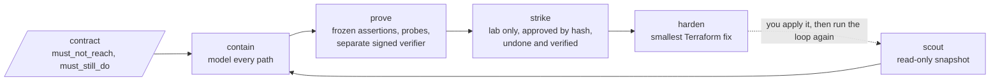
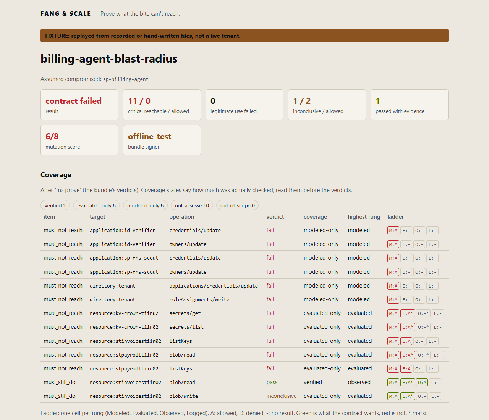

# Fang & Scale

[](https://github.com/danielguillaumont/fang-and-scale/actions/workflows/ci.yml)
[](https://github.com/danielguillaumont/fang-and-scale/actions/workflows/codeql.yml)
[](https://github.com/danielguillaumont/fang-and-scale/releases/latest)
[](LICENSE)
[](pyproject.toml)
[-2ea44f)](#install-and-verify-the-release)

**Unit tests for breach blast radius in Microsoft Entra and Azure.** Declare what a
compromised workload or agent identity must never reach and what it must still do.
Fang & Scale maps the paths to that boundary, attacks it, proposes the smallest
fix, proves the result with signed evidence, and fails CI if it regresses. Scout,
contain and prove have run live on a lab tenant; harden and the strikes are built
and tested offline.

> [!IMPORTANT]
> **Authorized use only.** Run it only against a tenant you own or have written
> permission to test, preferably a dedicated lab tenant like the one `lab/` builds.
> Report vulnerabilities privately: [SECURITY.md](SECURITY.md).

## Why

Workload and agent identities often hold far more than their job needs, and one
leaked credential turns that surplus into a breach: an app owner adds a secret,
an app grants itself a role, and a billing agent ends up assigning directory
roles. Assume the identity is already compromised and ask what it can reach. Then
prove the fix instead of trusting it: a forbidden item passes only when the model
finds no path and a live attempt is observed to fail. Anything the tool can't
model or observe is reported as `inconclusive`, never as a pass.

## What it does in 60 seconds



A contract is a few lines of YAML:

```yaml
# contracts/examples/billing-agent.fns.yaml (shortened)
version: 2
assume_compromised: sp:sp-billing-agent
must_not_reach:
  - resource: kv-crown-jewels
    operations: [secrets/get, secrets/list]
  - directory: tenant
    operations: [roleAssignments/write, applications/credentials/update]
  - application: id-verifier
    operations: [credentials/update, owners/update]
must_still_do:
  - resource: st-invoices
    operations: [blob/read, blob/write]
budget:
  max_critical_reachable: 0
```

Try it without a tenant: `fns demo contain --bundled` replays the hand-written demo
set that ships in the package. This is its real output, abbreviated. It is
generated by `scripts/render_images.py` and a test keeps it in sync; `[...]` marks
a cut, and each path step's provenance lines are left out.

<!-- demo-output:begin -->
```
$ fns demo contain --bundled
FIXTURE replaying the bundled hand-written demo set (not a recorded lab run)
[...]
FIXTURE contract billing-agent-blast-radius  compromised sp-billing-agent 00000000-0000-4000-8000-000000000100
FIXTURE snapshot sha256:505803b374fcbdce1af01b96dc46cdcaed9794bcecbcfc463ce09adff8db6a39  FIXTURE  semantics v2
FIXTURE evidence: rung 1 (modeled) only; nothing here was observed
FIXTURE coverage: modeled-only=6  not-assessed=2
FIXTURE Findings
FIXTURE   fail         not-reach modeled  modeled-only  tenant applications/credentials/update
FIXTURE   fail         not-reach modeled  modeled-only  tenant roleAssignments/write
FIXTURE   fail         not-reach modeled  modeled-only  kv-crown-jewels secrets/get
FIXTURE   fail         not-reach modeled  modeled-only  kv-crown-jewels secrets/list
FIXTURE   inconclusive not-reach -        not-assessed  stpayroll blob/read
FIXTURE   inconclusive not-reach -        not-assessed  stpayroll listKeys
FIXTURE   inconclusive still-do  modeled  modeled-only  stinvoices blob/read
FIXTURE   inconclusive still-do  modeled  modeled-only  stinvoices blob/write
[...]
FIXTURE FAIL directory:tenant roleAssignments/write  modeled / modeled-only
FIXTURE   1. [assume-compromised] assume sp-billing-agent is compromised
FIXTURE   2. [snapshot] sp-billing-agent holds the Graph permission Application.ReadWrite.OwnedBy
FIXTURE   3. [owner-adds-credential] sp-billing-agent owns app-escalation-target; with Application.ReadWrite.OwnedBy it adds a credential and signs in as app-escalation-target
FIXTURE   4. [snapshot] app-escalation-target holds the Graph permission AppRoleAssignment.ReadWrite.All
FIXTURE   5. [approle-self-grant] with AppRoleAssignment.ReadWrite.All, app-escalation-target grants app-escalation-target the Graph permission RoleManagement.ReadWrite.Directory
FIXTURE   6. [graph-permission] RoleManagement.ReadWrite.Directory allows roleAssignments/write on any object in the tenant
[...]
FIXTURE critical reachable: 4/0 max  must_still_do failed: 0  inconclusive: 4/2 max (on_inconclusive: fail)
FIXTURE contract FAILED (exit 1)
$ echo $?
1
```
<!-- demo-output:end -->

The demo contract fails on purpose: the agent owns another application, and that
ownership chains to directory-wide role assignment. Nothing above was observed:
every line is rung 1 (modeled) and labelled `FIXTURE`. The full walkthrough, on
the recorded live lab run, is in the [guide](docs/GUIDE.md#demo-from-a-checkout-no-tenant).

## Proven live

Every live run so far was on one dedicated lab tenant (Entra ID Free). Each is
recorded, sanitized and replayed as a regression test.

| Milestone | Live run | Result |
| --- | --- | --- |
| M1 Scout | 2026-11-26 | read-only snapshot of RBAC, Graph app roles, owners and directory roles, as the read-only scout identity (`fixtures/lab-run-1`) |
| M2 Contain | 2026-11-26 | 11 critical reachable, 2 inconclusive, exit 1, the same as the replay. PIM `not-applicable` with evidence (no P2 licence). Mutation in the model on that snapshot: 6/8, with two explained survivors (`fixtures/lab-run-2`) |
| M3 Prove | 2026-11-26 | 14 read-only `GET`/`HEAD` requests as the compromised identity, through the scope gate. Invoices `blob/read` observed allowed: **pass, verified**. Key Vault and payroll reads observed denied, but escalation paths remain, so they still **fail**. Exit 1 (`fixtures/lab-run-3`) |
| M4 log path | 2026-11-27 | Entra audit and service-principal sign-in logs reach a Log Analytics workspace on Entra ID Free, about 10 to 15 minutes after the event (`docs/FINDINGS.md`) |
| M4 harden, strikes, detections | pending | **built and tested offline, live run pending** (`docs/runbooks/m4-live-run.md`) |

What each fixture proves, item by item: [Real vs. fixture](docs/GUIDE.md#real-vs-fixture).

## Evidence ladder

Every finding carries the highest rung its evidence reached and a coverage state.
A `must_not_reach` item passes only with an observed denial, every modeled path
refuted, and no open surface (such as uncollected PIM eligibility).

| Rung | Means | Status |
| --- | --- | --- |
| 1 modeled | the reach model says so, from a snapshot | live since M1 |
| 2 evaluated | Azure's own permission evaluation agrees | live in M3 (9 probes) |
| 3 observed | a live, non-destructive attempt saw it | live in M3 (4 reads: 1 allowed, 3 denied) |
| 4 logged | the attempt also shows up in the logs | rules written; never run in a workspace |

Coverage states: `verified`, `evaluated-only`, `modeled-only`, `not-assessed`,
`out-of-scope`. Reports lead with coverage, not a risk score. A contract can
accept named items as `inconclusive`, each with a written reason; any other
inconclusive item is over budget. One deliberate limit: `roleAssignments/write`
on the directory never passes, because the only direct test would be to assign a
directory role, and the tool never does.

## Sample report

`fns report` writes one self-contained HTML page: coverage first, then the reach
graph, findings and paths, the signed proof bundle and the mutation results. It
opens offline and makes no network request.

[](docs/sample-report/report.FIXTURE.html)

`docs/sample-report/report.FIXTURE.html` is `fns demo report` on the recorded M3
lab run: a FIXTURE replay, labelled as one. Download it and open it in a browser.

## Install and verify the release

Python 3.12. Not on PyPI. Download the v0.1.0 wheel, check its build provenance
attestation, then install that file:

```
gh release download v0.1.0 -R danielguillaumont/fang-and-scale -p "*.whl" -D fns-0.1.0
gh attestation verify fns-0.1.0/fang_and_scale-0.1.0-py3-none-any.whl -R danielguillaumont/fang-and-scale
pipx install --python 3.12 fns-0.1.0/fang_and_scale-0.1.0-py3-none-any.whl
fns demo contain --bundled
```

`gh attestation verify` checks that the file was built by this repository's
`release.yml` from the `v0.1.0` tag, with a Sigstore-signed provenance statement.
Or install straight from the tag:
`pipx install --python 3.12 "git+https://github.com/danielguillaumont/fang-and-scale@v0.1.0"`.
For keyless Sigstore signing of your own runs (`fns prove --sign sigstore`), add the
`sigstore` extra. The [quickstart](docs/QUICKSTART.md) walks through every demo in
under 5 minutes.

## Safety model

- **Scope gate.** Every Azure and Graph request, page and retry goes through
  `fns.scope.gate`. It denies by default, pins the tenant (a mismatch exits 4),
  and checks operations, targets, URLs, budget and expiry.
- **Writes are denied by default.** Only `fns strike` writes to Azure or Entra:
  only to Terraform-tagged lab objects, only the planned write forms, and only
  after `--approve <plan-hash>`. A hard denylist that no scope can lift comes
  first. Every write has an undo that runs whatever happens, and a second,
  read-only identity checks the result. `fns harden` only writes a diff;
  `harden --apply` is not built.
- **A separate verifier.** `fns verify` runs in its own process with no
  credentials and judges only the frozen assertions and the journal. Import
  contracts keep it from importing the prover, the probes or the executor.
- **No secrets persisted.** Sign-in goes through the Azure CLI or OIDC. Secrets
  are stripped inside the transport, tokens are never written, and fixtures use
  placeholder GUIDs that a test scans.
- **Lab only.** Live commands are meant for a dedicated lab tenant, and anything
  replayed from a fixture prints `FIXTURE`.

How each boundary is enforced: [ARCHITECTURE](docs/ARCHITECTURE.md). What happens
when the tool, a fixture, a scope file or tenant data is hostile, including what
does not hold: [THREAT-MODEL](docs/THREAT-MODEL.md).

Exit codes: 0 within budget, 1 contract failed, 2 usage or invalid input,
3 inconclusive over budget, 4 scope denied, 5 evidence invalid. Exit 1 also
means that the check a command runs has failed:

- survivors over `--max-survivors` in `fns mutate`;
- no proposal in `fns harden`;
- a conflict in `fns record`;
- problems found by `fns detections check`;
- drift found by `fns schema --check`.

A missing or invalid contract, scope, snapshot, report or log file exits 2, and
so does an internal error, so a crash never looks like a verdict.

## Verify a signed result

Every push to `main` runs `prove-sign`: the isolated verifier judges the recorded
lab-run-3 replay and signs its evidence bundle with Sigstore keyless signing,
using the workflow's own GitHub OIDC identity. The entry goes into the public
Rekor log. The signed run directory is uploaded as the workflow artifact
`prove-sign-production-<commit sha>` (kept 30 days).

What a valid signature proves: this exact bundle was produced by
`.github/workflows/prove-sign.yml` on `main` of this repository, at the commit
in the certificate. It does not make the result live: the statement says
`mode: FIXTURE`, and its inputs are the sanitized lab recording.

Download the latest one (any GitHub account can download artifacts of a public
repository):

```
sha=$(gh run list -R danielguillaumont/fang-and-scale --workflow prove-sign \
  --branch main --event push --status success -L 1 --json headSha -q '.[0].headSha')
gh run download -R danielguillaumont/fang-and-scale -n "prove-sign-production-$sha" -D run
```

Check the signature with the Sigstore client alone (sigstore-python, the same
library the workflow signs with). It verifies the certificate chain, the Rekor
inclusion proof, the signing identity, and that `assertions.json` is a subject of
the signed in-toto statement:

```
uvx sigstore@4.6.0 verify github \
  --bundle run/bundle.sigstore.json \
  --cert-identity https://github.com/danielguillaumont/fang-and-scale/.github/workflows/prove-sign.yml@refs/heads/main \
  --repository danielguillaumont/fang-and-scale \
  --trigger push \
  run/assertions.json
```

Then, from a checkout of this repository, re-check everything else: every
subject digest, and that each verdict follows from the frozen inputs:

```
uv sync --extra sigstore
uv run python -m fns.verify check --run run \
  --sigstore-instance production \
  --sigstore-identity https://github.com/danielguillaumont/fang-and-scale/.github/workflows/prove-sign.yml@refs/heads/main \
  --sigstore-issuer https://token.actions.githubusercontent.com
```

Both print `OK` / `verified` or fail. A pull request run signs on Sigstore
**staging** instead: add `--staging` before `verify` and use
`--sigstore-instance staging`, with the pull request's identity
(`...prove-sign.yml@refs/pull/<n>/merge`). Staging bundles prove the pipeline,
not a trusted log, and reports label them `Sigstore STAGING`.

## Project status

- **v0.1.0 released 2026-11-27**, with build provenance attestations
  ([CHANGELOG](CHANGELOG.md)). A personal research project: one maintainer, one
  lab tenant, public since 2026-11-26.
- **Ran live:** scout (M1), contain (M2), and prove with probes as the
  compromised identity (M3), all on 2026-11-26, and the M4 log path check on
  2026-11-27.
- **Built and tested offline only:** harden, record mode, the KQL detections,
  the strike engine (S1 to S4 before harden, D-1 to D-7 after), mutation testing,
  the HTML report, the GitHub Action and the MCP server. Nothing from M4 has run
  against a real tenant yet.
- **On every push to `main`:** tests on Ubuntu and Windows, the built wheel
  installed in a clean venv, CodeQL, and a Sigstore production signature of the
  recorded M3 replay.

Day-to-day state: `docs/STATUS.md`.

## Roadmap

| Milestone | Scope | State |
| --- | --- | --- |
| M1 Lab + contracts | Terraform lab, scope gate, scout, schemas | done, live |
| M2 Contain | reach engine, escalation rules, settings and PIM collectors | done, live |
| M3 Prove | freeze, probes, isolated verifier, signed bundle | done, live |
| M4 Harden + detect | minimizer, record mode, KQL rules, strikes | built offline; **live run next**: `docs/runbooks/m4-live-run.md` (the log path check passed: `docs/runbooks/m4-log-path-check.md`) |
| M5 Mutation + CI | mutation score, HTML report, GitHub Action | done; v0.1.0 released |
| M6 Strike + agents | Agent ID, the MCP server, an LLM proposer bake-off | started: the read-only MCP server, Agent ID findings `not-assessed`; design notes in `docs/milestones/` |

## Docs

| Doc | What is in it |
| --- | --- |
| [QUICKSTART](docs/QUICKSTART.md) | every `fns demo` in under 5 minutes, installed or from a checkout |
| [GUIDE](docs/GUIDE.md) | the full demo, how the pieces fit, real vs. fixture, the MCP server, the lab, development |
| [GitHub Action](docs/ACTION.md) | use the action from another repository: inputs, outputs, the sticky comment, pinning, an example on a bundled FIXTURE |
| [PERFORMANCE](docs/PERFORMANCE.md) | a synthetic 10,000-SP tenant: scout replay and contain time and memory, and where the time goes |
| [Scenario gallery](docs/scenarios/README.md) | five FIXTURE tenants, each a common misconfiguration: the story, the contract, the verdicts before and after the smallest fix |
| [ARCHITECTURE](docs/ARCHITECTURE.md) | the trust boundaries, with diagrams, and what enforces each |
| [THREAT-MODEL](docs/THREAT-MODEL.md) | hostile inputs, and what does not hold |
| [PLAN](docs/PLAN.md) | the product plan |
| [FINDINGS](docs/FINDINGS.md) | where Microsoft APIs behave differently from their docs |
| [DECISIONS](docs/DECISIONS.md) | every non-trivial choice, and who approved it |
| [Runbooks](docs/runbooks/) | every live session, command by command |
| [CHANGELOG](CHANGELOG.md) | what changed in each release |

Other commands: `fns harden`, `fns record` (logs to `must_still_do`),
`fns detections check|export` (KQL rules as code), `fns mutate`, `fns comment`,
`fns mcp serve` and `fns scope check`. Run `fns --help` for the full list.

## Security and contributing

Report vulnerabilities privately: [SECURITY.md](SECURITY.md). Contributions:
[CONTRIBUTING.md](CONTRIBUTING.md).

## License

Apache-2.0. See `LICENSE`.

Microsoft, Azure and Microsoft Entra are trademarks of the Microsoft group of
companies. This project is not affiliated with or endorsed by Microsoft.
