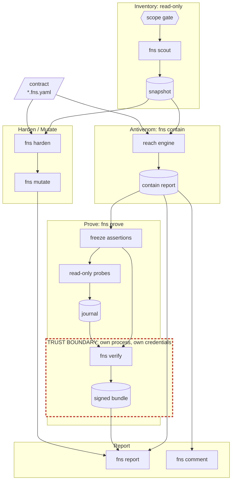
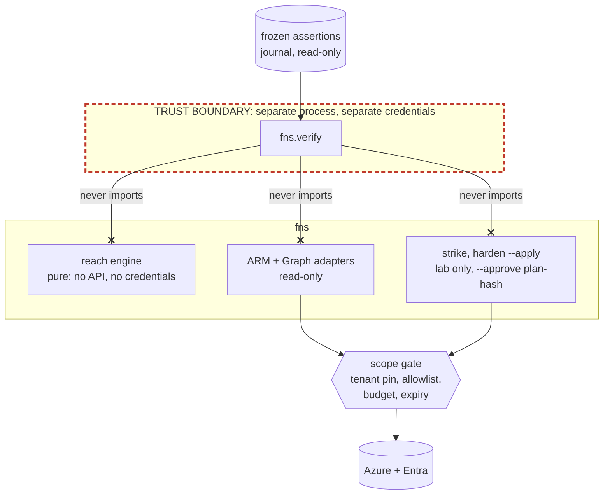

# Fang & Scale

**Unit tests for breach blast radius in Microsoft Entra and Azure.**

Declare what a compromised workload or agent identity must never reach and what it
must still do. Fang & Scale finds the escalation paths its rules model to that
boundary, proposes the smallest Terraform fix it can find, checks the result with
read-only probes and signed evidence, and fails CI if it regresses. Anything it
cannot model or probe is reported as `inconclusive`, never as a pass.

*Challenge the defence. Reduce the damage. Prove the improvement.*

> [!IMPORTANT]
> **Authorized use only.** Run Fang & Scale only against a tenant you own or have
> written permission to test, preferably a dedicated lab tenant like the one
> `lab/` builds. It reads directory and RBAC data, and `fns prove --live` sends
> real requests as the identity a contract names. Report vulnerabilities
> privately: see [SECURITY.md](SECURITY.md).

```yaml
# contracts/examples/billing-agent.fns.yaml (shortened)
version: 2
assume_compromised: sp:sp-billing-agent
must_not_reach:
  - resource: kv-crown-jewels
    operations: [secrets/get, secrets/list]
  - directory: tenant
    operations: [roleAssignments/write, applications/credentials/update]
  - application: id-verifier
    operations: [credentials/update, owners/update]
must_still_do:
  - resource: st-invoices
    operations: [blob/read, blob/write]
budget:
  max_critical_reachable: 0
```

> **Status.** A personal research project: one maintainer, one lab tenant, no
> release yet. M1, M2 and M3 are done and ran live. In M3 the probes ran as the
> assumed-compromised identity itself (`docs/runbooks/m3-live-run.md`). M4 and M5
> are built and tested offline, against the recorded lab runs and hand-written
> fixtures. See [Real vs. fixture](#real-vs-fixture) before you trust any result.

## 90-second demo (no tenant)

Requires [uv](https://docs.astral.sh/uv/) and a clone of this repository. The
demo commands replay `fixtures/lab-run-3`, the live lab run recorded in M3 and
sanitized. Its scout ran as `sp-fns-scout`, and its probes ran as
`sp-billing-agent`. `fixtures/lab-run-1` and `fixtures/lab-run-2` are the M1 and
M2 runs. Every line they print starts with
`FIXTURE`, and none of them makes a network call.

```
uv sync
uv run fns demo contain      # 1. What can a compromised billing agent reach?
uv run fns demo prove        # 2. Freeze assertions, replay probes, verify in a separate process
uv run fns demo mutate       # 3. Harden the lab in the model, then try to break the contract
uv run fns demo report       # 4. One HTML page: .fns/report.FIXTURE.html
```

**1. Contain.** The seeded lab contract fails on purpose (exit 1): 11 critical
findings. The agent's owner rights on another application lead to directory-wide
role assignment (output shortened):

```
FIXTURE FAIL directory:tenant roleAssignments/write  modeled / modeled-only
FIXTURE   1. [assume-compromised] assume sp-billing-agent is compromised
FIXTURE   2. [snapshot] sp-billing-agent holds the Graph permission Application.ReadWrite.OwnedBy
FIXTURE   3. [owner-adds-credential] sp-billing-agent owns app-escalation-target; with
FIXTURE      Application.ReadWrite.OwnedBy it adds a credential and signs in as app-escalation-target
FIXTURE   4. [snapshot] app-escalation-target holds the Graph permission AppRoleAssignment.ReadWrite.All
FIXTURE   5. [approle-self-grant] ... grants app-escalation-target RoleManagement.ReadWrite.Directory
FIXTURE   6. [graph-permission] RoleManagement.ReadWrite.Directory allows roleAssignments/write ...
```

**2. Prove.** Assertions are frozen and hashed before any probe runs. The verifier
then runs as a separate process that reads only those assertions and the journal.
It judges each path and signs an in-toto statement in a DSSE envelope. The demo
uses an offline key, and the output labels it `TEST SIGNATURE`. Run
`uv run fns verify .fns/runs/<run id>` to check a run; tampering exits 5.

**3. Harden and mutate.** `fns harden` searches the grants it can map in
`lab/*.tf`, smallest set first, for the smallest removal that takes the lab to 0
critical findings in the model while keeping legitimate use: drop the agent's
`Application.ReadWrite.OwnedBy` and its resource-group `Contributor`. It writes a
diff and a plan hash; it never applies anything. Mutation
testing then puts back one dangerous grant at a time. **Mutation testing found a
gap in our own contract:** the first run caught 5 of 8, because contract version 1
could not name one application. Version 2 can, and the seeded contract now guards
the verifier and scout applications and the invoice account's keys. It catches 6
of 8. The two survivors make the agent an owner of `id-verifier` or `sp-fns-scout`.
In the hardened lab the agent holds no Graph permission that can use an ownership,
so the model gains no reach, and the output says exactly that
(`docs/FINDINGS.md`). They are accepted as explained survivors: no contract line
can kill them, and the Graph grant that would make the ownership usable is
already caught.

**4. Report.** Coverage comes first, then the reach graph, findings and paths, the
proof bundle and the mutation results. It is one self-contained HTML file with
Cytoscape.js embedded (MIT, `src/fns/report/vendor/`), so it opens offline and
makes no network request.

Other commands: `fns harden`, `fns record` (turns logs into `must_still_do`),
`fns detections check|export` (KQL rules as code), `fns comment`, and
`fns scope check`. Run `uv run fns --help` for the full list.

## Architecture

**Main flow.** Rectangles are steps, cylinders are the files they write.



**Trust boundaries.** Only the scope gate talks to Azure. Only two commands can
write, and only to the lab. The verifier shares no code with what it checks.



Two import contracts enforce the boundaries. `fns.verify` imports nothing from
the reach engine, probes, prover, harden, adapters or scope. The reach engine
cannot import adapters, credentials, the journal, strike or harden.

## Evidence ladder

Every finding carries the highest rung its supporting evidence reached and a
coverage state. Probe results that settle nothing (for example a denied read while
an escalation path remains) stay in the finding as context and never raise its
coverage. Semantics the model does not support give `inconclusive`, never `pass`. A missing path is
not proof of absence either: a `must_not_reach` item passes only with an observed
denial, every path refuted, and no open surfaces.

| Rung | Means | Produced by | Status |
| --- | --- | --- | --- |
| 1 modeled | the reach model says so, from a snapshot | `fns contain` | built; live scout ran in M1 |
| 2 evaluated | Azure's own permission evaluation agrees | `fns prove` (ARM permissions probe) | built; ran live in M3 (9 probes) |
| 3 observed | a live, non-destructive probe saw it | `fns prove` (data-read probe) | built; ran live in M3: 4 reads as the test identity, 1 allowed and 3 denied |
| 4 logged | the probe also shows up in the logs | detections (M4 K4) | rules written; never run in a workspace |

Coverage states: `verified`, `evaluated-only`, `modeled-only`, `not-assessed`,
`out-of-scope`. Reports lead with coverage, not a risk score.

## Real vs. fixture

| What | Evidence so far |
| --- | --- |
| Scout (RBAC, Graph, owners, roles) | **Live** on the lab tenant, 2026-11-26, three times. Recorded and sanitized as `fixtures/lab-run-1` (M1), `fixtures/lab-run-2` (M2) and `fixtures/lab-run-3` (M3). The M3 digest is identical to M2's. |
| Key Vault and storage settings collectors (M2 C1) | **Live** in the M2 run, 2026-11-26: one vault and two storage accounts, `complete`. |
| PIM eligibility collector | **Live** in the M2 run, as `not-applicable` with evidence: the lab tenant is Entra ID Free (0 SKUs), and Graph and ARM both answered `400 AadPremiumLicenseRequired`. The `collected` path, in a tenant with P2, is mocked tests only. |
| Reach engine and contracts (`fns contain`) | **Live** on the M2 snapshot, signed in as the read-only scout: 11 critical reachable, 2 inconclusive, exit 1, the same as the fixture replay. Results are rung 1 (modeled). The replay of `fixtures/lab-run-2` with its contract is a committed regression test. |
| Prove: probe results | **Live** on the lab, 2026-11-26, signed in as `sp-billing-agent`. There were 14 `GET` and `HEAD` requests through the scope gate, all allowed by it. Result: passed 1 (invoices `blob/read`, observed), critical reachable 11, inconclusive 1, exit 1. The Key Vault and payroll reads were denied when probed, but escalation paths remain, so they still fail. The results are recorded and sanitized as `fixtures/lab-run-3/probes.json`, and its replay is the M3 regression test, with the same verdicts. The `probes.json` in lab-run-1 and lab-run-2 stays hand-written. |
| Signing | The live run is signed with the offline test key, labelled `TEST`. In CI, `prove-sign` signs the lab-run-3 replay with Sigstore keyless signing: **production** (public Rekor log) on every push to `main`, staging on pull requests. It signs a FIXTURE replay, not a live run. See [Verify a signed result](#verify-a-signed-result). |
| Harden, mutate | Model only, on the recorded snapshot and `lab/*.tf`. Nothing applied. `fns mutate --harden` on the live M2 snapshot scored 6/8, with the two accepted app-owner survivors. |
| Record mode | Hand-written sample logs. |
| Detections | Structural lint only; never deployed. |
| GitHub Action | Runs on this repo's PRs against `fixtures/lab-run-1`; no Azure login. |

Anything replayed from a fixture prints `FIXTURE`, and reports built from one say
so in the title.

## Verify a signed result

Every push to `main` runs `prove-sign`: the isolated verifier judges the recorded
lab-run-3 replay and signs its evidence bundle with Sigstore keyless signing,
using the workflow's own GitHub OIDC identity. The entry goes into the public
Rekor log. The signed run directory is uploaded as the workflow artifact
`prove-sign-production-<commit sha>` (kept 30 days).

What a valid signature proves: this exact bundle was produced by
`.github/workflows/prove-sign.yml` on `main` of this repository, at the commit
in the certificate. It does not make the result live: the statement says
`mode: FIXTURE`, and its inputs are the sanitized lab recording.

Download the latest one (any GitHub account can download artifacts of a public
repository):

```
sha=$(gh run list -R danielguillaumont/fang-and-scale --workflow prove-sign \
  --branch main --event push --status success -L 1 --json headSha -q '.[0].headSha')
gh run download -R danielguillaumont/fang-and-scale -n "prove-sign-production-$sha" -D run
```

Check the signature with the Sigstore client alone (sigstore-python, the same
library the workflow signs with). It verifies the certificate chain, the Rekor
inclusion proof, the signing identity, and that `assertions.json` is a subject of
the signed in-toto statement:

```
uvx sigstore@4.6.0 verify github \
  --bundle run/bundle.sigstore.json \
  --cert-identity https://github.com/danielguillaumont/fang-and-scale/.github/workflows/prove-sign.yml@refs/heads/main \
  --repository danielguillaumont/fang-and-scale \
  --trigger push \
  run/assertions.json
```

Then, from a checkout of this repository, re-check everything else: every
subject digest, and that each verdict follows from the frozen inputs:

```
uv sync --extra sigstore
uv run python -m fns.verify check --run run \
  --sigstore-instance production \
  --sigstore-identity https://github.com/danielguillaumont/fang-and-scale/.github/workflows/prove-sign.yml@refs/heads/main \
  --sigstore-issuer https://token.actions.githubusercontent.com
```

Both print `OK` / `verified` or fail. A pull request run signs on Sigstore
**staging** instead: add `--staging` before `verify` and use
`--sigstore-instance staging`, with the pull request's identity
(`...prove-sign.yml@refs/pull/<n>/merge`). Staging bundles prove the pipeline,
not a trusted log, and reports label them `Sigstore STAGING`.

## Safety

- **Read-only by default.** Only `strike` and `harden --apply` may ever write, only
  to the lab, and only after `--approve <plan-hash>`. Neither is built:
  `harden --apply` refuses.
- **Scope gate.** Every Azure and Graph request, page and retry goes through
  `fns.scope.gate`. Anything missing, expired or mismatched is denied. The gate has
  negative tests for each rule and Hypothesis property tests.
- **Tenant pinning.** A run stops (exit 4) if the token's tenant differs from the
  scope manifest.
- **No secrets.** Sign-in goes through the Azure CLI or OIDC. Fixtures use
  placeholder GUIDs, and a test scans them.
- **Untrusted input.** Tenant names and texts are escaped in the HTML report and
  in the PR comment.

Exit codes: 0 within budget, 1 contract failed, 2 usage or invalid input,
3 inconclusive over budget, 4 scope denied, 5 evidence invalid. Exit 1 also
means that the check a command runs has failed:

- survivors over `--max-survivors` in `fns mutate`;
- no proposal in `fns harden`;
- a conflict in `fns record`;
- problems found by `fns detections check`;
- drift found by `fns schema --check`.

A missing or invalid contract, scope, snapshot, report or log file exits 2, and
so does an internal error, so a crash never looks like a verdict.

## Project status

- **Public since 2026-11-26.** One maintainer, no release yet; the first tag
  meant for users is `v0.1` (M5).
- **Ran live, on one lab tenant:** scout (M1), contain (M2), and prove with
  probes as the compromised identity (M3), all on 2026-11-26. Each run is
  recorded as a fixture and replayed as a regression test.
- **Built and tested offline only:** harden, record mode, detections (M4) and
  mutation testing, the HTML report and the GitHub Action (M5).
- **On every push to `main`:** tests on ubuntu and windows, CodeQL, and a
  Sigstore production signature of the recorded M3 replay.
- **The lab is torn down.** The next live work is M4: harden the lab, prove the
  fix, and run the detections in a Log Analytics workspace. Spec:
  `docs/milestones/M4.md`.

Day-to-day state: `docs/STATUS.md`. What each fixture proves: [Real vs.
fixture](#real-vs-fixture).

## Roadmap

| Milestone | Scope | State |
| --- | --- | --- |
| M1 Lab + contracts | Terraform lab, scope gate, scout, schemas | done, live |
| M2 Contain | reach engine, escalation rules, settings and PIM collectors | done, live (tag `m2`) |
| M3 Prove | freeze, probes, isolated verifier, signed bundle | **done**: live probes ran on 2026-11-26 (`fixtures/lab-run-3`); Sigstore production signing in CI on every push to `main` (staging on pull requests) |
| M4 Harden + detect | minimizer, record mode, KQL rules | built offline; live loop pending approval |
| M5 Mutation + CI | mutation score, HTML report, GitHub Action, README | built; v0.1 tag pending |
| M6 Strike + agents | non-destructive strikes, Agent ID, MCP server | not started |

Design: `docs/PLAN.md`. Milestone specs: `docs/milestones/`. Every non-trivial
choice: `docs/DECISIONS.md`. Places where Microsoft APIs behave differently from
their documentation: `docs/FINDINGS.md`.

## Lab and live runs

`lab/` is a Terraform lab (azurerm + azuread) for a **dedicated lab tenant**. It
contains:

- an over-privileged `sp-billing-agent`;
- a Key Vault and storage holding synthetic data;
- a privileged `app-escalation-target` owned by the agent;
- a read-only `id-verifier` and a read-only `sp-fns-scout`.

`uv run poe lab-up` applies it and writes `scope.lab.yaml` (gitignored).
`uv run poe lab-down` destroys it. Terraform refuses to run if the signed-in tenant
differs from `tenant_id`.

```
uv run poe scout                                       # live, read-only
uv run fns scout --record fixtures/my-run            # also save a sanitized fixture set
uv run fns demo scout --fixture fixtures/my-run      # replay it later, no tenant needed
```

### Scout permissions

The scout identity (`sp-fns-scout`) gets exactly these grants, and none of them
can write:

| Grant | Scope | Used for |
| --- | --- | --- |
| Azure RBAC **Reader** | lab subscription | role assignments and definitions, deny assignments, resources, and Key Vault and storage settings (access policies, permission model, shared-key access) |
| Graph **Application.Read.All** (application) | tenant | service principals, applications, their owners, app role assignments |
| Graph **RoleManagement.Read.Directory** (application) | tenant | directory role definitions, assignments and PIM eligibility schedules |
| Graph **LicenseAssignment.Read.All** (application) | tenant | `/subscribedSkus`: the evidence that a tenant without PIM has no PIM |
| Graph **Directory.Read.All** (application) | tenant | `memberOf`, and resolving owners and members that are users or groups |

- **Reader** is `*/read` only: no actions (so no `listKeys`) and no data plane.
  It also covers Azure resource PIM eligibility (`roleEligibilitySchedules/read`).
- The three Graph read permissions are the least-privileged ones documented for
  those endpoints.
- **PIM eligibility.** When the scope allows it, the scout lists eligible role
  assignments. If the tenant has no PIM licence, it records `pim-eligibility` as
  *not applicable*, with the responses as evidence. It never infers this from a
  failure alone. Otherwise every finding stays inconclusive on PIM.
- **Directory.Read.All** is the broadest grant here. The first live run showed the
  set is sufficient. Whether it can be dropped is the next live test
  (`docs/runbooks/m1-live-run.md`, `docs/FINDINGS.md`).

The scope manifest narrows this further. It allows only the read operations listed
in `scope.lab.yaml`, only inside the lab subscription and resource group, within a
call and time budget, and only until `expires_at`.

## Development

Works on Windows, macOS and Linux. CI runs on ubuntu and windows.

```
uv run poe setup      # uv sync --all-groups --all-extras, then pre-commit hooks
uv run poe check      # ruff + mypy --strict + import boundaries + schema drift + pytest
uv run poe lab-check  # terraform fmt -check + validate (no credentials needed)
uv run poe schema     # regenerate the committed JSON Schemas in schemas/
```

Sync with `--all-extras` as well as `--all-groups` (`poe setup` does): `sigstore`
is an extra, because `fns prove --sign sigstore` is part of the installed tool,
and a plain `uv sync --all-groups` uninstalls it.

## Security and contributing

Report vulnerabilities privately: [SECURITY.md](SECURITY.md). Contributions:
[CONTRIBUTING.md](CONTRIBUTING.md).

## License

Apache-2.0. See `LICENSE`.

Microsoft, Azure and Microsoft Entra are trademarks of the Microsoft group of
companies. This project is not affiliated with or endorsed by Microsoft.
