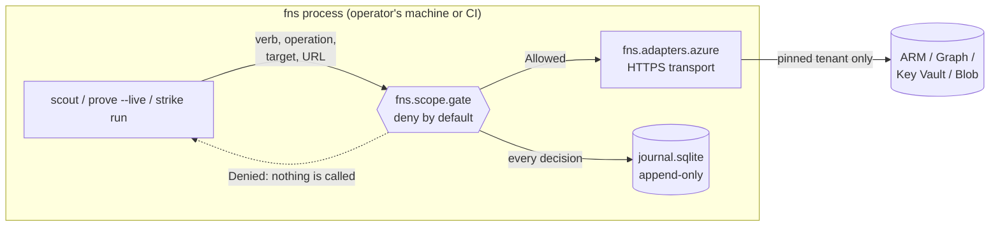
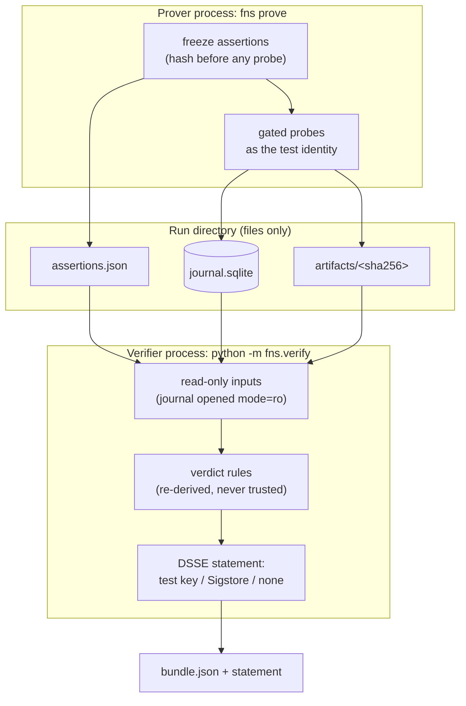
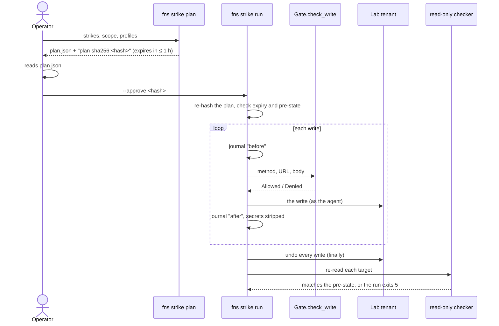
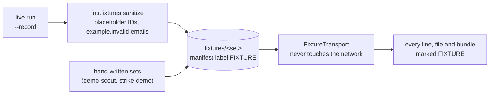

# Architecture

How Fang & Scale is put together, and where its trust boundaries are. The
product reasoning is in [PLAN.md](PLAN.md) (section 6). What can go wrong when
a piece is hostile is in [THREAT-MODEL.md](THREAT-MODEL.md). Each choice made
along the way has a row in [DECISIONS.md](DECISIONS.md).

Every boundary below is enforced by code or by a test, not only by convention.
The "Enforced by" lines name them; `tests/test_architecture_docs.py` checks that
the named files and contracts still exist.

## The pieces

One Python package, `fns`, with one CLI (`fns`). Grouped by role:

| Role | Packages | Holds credentials? | Writes to a tenant? |
| --- | --- | --- | --- |
| **Gate** | `fns.scope` (`gate`, `writes`, `targets`, `credentials`) | builds them, pinned to the scope's tenant | decides; never calls |
| **Adapters** | `fns.adapters.azure` (`http`, `arm`, `graph`, `dataplane`, `live`) | uses what the gate hands it | only the forms `fns.scope.writes` allows |
| **Collector** | `fns.inventory`, `fns.scout` | the scout identity (read-only) | no |
| **Reach model** | `fns.contain` | no (pure) | no |
| **Proposer** | `fns.harden`, `fns.mutate` | no | no: it writes a diff for a person to apply |
| **Prover** | `fns.prove`, `fns.probes` | the pinned test identity, for read probes | no |
| **Executor** | `fns.strike` | two lab identities: the agent and a read-only checker | yes: lab targets only, after `--approve <plan hash>` |
| **Verifier** | `fns.verify` | **none** (its own OIDC token in CI, for Sigstore only) | no |
| **Evidence store** | `fns.journal` (append-only SQLite), content-addressed `artifacts/` | no | no |
| **Shared** | `fns.models` (frozen Pydantic models), `fns.yamlio`, `fns.fixtures` | no | no |
| **Output** | `fns.report` (HTML, Markdown, text), `fns.cli` | no | no |
| **MCP server** | `fns.mcp` (`fns mcp serve`, stdio) | no | no: read-only tools only |

## Boundary 1: every call goes through the gate

- `Gate.check` runs a fixed list of conditions, and the first failure wins:
  - the manifest is present and has not expired;
  - the signed-in tenant, the manifest's tenant and the call's tenant are all equal;
  - the verb and the operation are listed;
  - the target is in scope;
  - the URL has the exact host and path;
  - `prove` and `strike` act only as a pinned test identity;
  - the budget is not used up.

  Any exception inside the gate is a denial.
- Writes take a separate path, `Gate.check_write`. It applies:
  - a hard denylist that no scope can lift (directory roles, permission grants,
    ARM authorization, logging and detection providers, Microsoft first-party
    IDs);
  - an exact write form;
  - a body allowlist that binds every object ID to a lab target.
- A `nextLink` is untrusted API output, so the gate checks it like any other URL.

Enforced by:
- `fns.scope.gate`, `fns.scope.writes`;
- `tests/scope/test_gate_table.py`, `tests/scope/test_gate_fuzz.py`,
  `tests/scope/test_gate_writes.py`, `tests/scope/test_gate_writes_fuzz.py`;
- the import contract "Reach engine is pure: no API access, credentials,
  journal, executor or proposer".

## Boundary 2: the verifier stands apart

- The prover hands over **files**, not objects. The verifier is started as a new
  interpreter (`sys.executable -m fns.verify`). Its environment is scrubbed of
  Azure and executor credentials, and `AZURE_CONFIG_DIR` points to an empty
  directory made for that one process, so it cannot find an `az` login.
- The verifier re-hashes every artifact. It refuses evidence recorded before the
  freeze, and evidence from another mode (LIVE vs FIXTURE) or another run. It
  re-derives each verdict from the inputs. `fns verify check` does all of that
  again on a finished run, plus the signature.
- Strike results reach the verifier the same way: `prove --after-strike` writes
  `StrikeObservation` artifacts and journals them after the freeze. A strike can
  only add context or make a verdict stricter (`GuardrailError`).

Enforced by:
- the import contracts "Verifier is isolated from proposer, executor and
  adapters" and "Probes and the prove orchestrator never import the verifier";
- `fns.prove.run.verifier_env`;
- `tests/prove/test_verifier_isolation.py`, `tests/prove/test_integrity.py`,
  `tests/prove/test_after_strike.py`.

## Boundary 3: the executor writes only what a person approved

- A strike run refuses to start:
  - without the exact plan hash;
  - after the plan expires (1 hour at most);
  - if the pre-state has changed since planning.
- The writer and the checker are two different identities, from two Azure CLI
  profiles. The checker uses the scout's read-only reader. It never sees the
  writer's credentials.
- Cleanup is driven by the journal. It repeats each undo until it gets a 2xx,
  so a crash never leaves a write without its undo on record.
- The executor never imports the verifier, the prover, the reach model or the
  proposer. It cannot grade itself.

Enforced by:
- the import contract "Strike engine never imports the verifier, the prover or
  the proposer";
- `fns.strike.plan`, `fns.strike.run`;
- `tests/strike/test_plan.py`, `tests/strike/test_run.py`,
  `tests/strike/test_secrets.py`.

## Boundary 4: recorded and hand-written data stay labelled

- A fixture set must say `"label": "FIXTURE"` in its manifest, or it is refused.
  A request with no recorded response is an error. Replay never invents an empty
  result.
- FIXTURE and LIVE never mix in one run. The verifier checks the mode of every
  artifact against the run's.
- The sanitizer's ID map stays out of the repository. Committed fixtures carry
  placeholder GUIDs only.

Enforced by:
- `fns.fixtures.replay`, `fns.console.FixtureConsole`;
- `tests/fixtures/test_replay.py`, `tests/fixtures/test_sanitize.py`,
  `tests/fixtures/test_no_real_ids.py`.

## Boundary 5: tenant data is untrusted input

Display names, descriptions, `nextLink`s and log rows come from the tenant, and
anyone who can edit an object in it can choose them. So:
- the report escapes every tenant string and embeds the graph data as escaped
  JSON shown with `textContent`, under a Content-Security-Policy that allows
  only the vendored, hash-pinned Cytoscape;
- the pull-request comment escapes Markdown, mentions and HTML in one pass;
- workflow scripts never expand `${{ }}` inside `run:`.

Enforced by: `tests/test_report_html.py`, `tests/test_report_strikes.py`,
`tests/test_action.py`.

## Boundary 6: the MCP server only reads

`fns mcp serve` gives an MCP client, usually an assistant, five read-only tools:
fixture sets, contain reports, and `fns contain` on a fixture.

- **No write and no network.** It has no write tool and makes no network call.
  `contain_fixture` replays through `FixtureTransport` in a temporary directory
  that is removed afterwards.
- **Fixture files from a fixed list.** It opens only `contract.fns.yaml`,
  `detections.yaml`, `manifest.json`, `probes.json` and `scope.yaml`. The
  sanitizer's ID map and the recorded exchanges cannot be listed or read.
- **Reports only when asked.** Reports come only from `--reports`, and only
  FIXTURE ones unless the operator passes `--include-live`.
- **Safe names.** Names must match a pattern and resolve directly inside their
  root. Large files and long lines are refused.

Enforced by:
- the import contract "MCP server is read-only: no live transport, credentials,
  executor, prover, proposer or verifier";
- `fns.mcp.server`;
- `tests/mcp/test_server.py`: a canary ID map, and a socket that raises if any
  connection is opened.

## Run state and exit codes

Every command that touches a tenant journals its steps in SQLite. The keyed
steps are idempotent: resuming a run never repeats a write and never counts a
crash as a pass. Exit codes are fixed and tested (`tests/test_exit_codes.py`):

| Code | Meaning |
| --- | --- |
| 0 | within the contract's budget |
| 1 | the contract failed |
| 2 | usage error or invalid input |
| 3 | too many items `inconclusive` |
| 4 | the scope gate refused something |
| 5 | the evidence did not check out |

## What is not a boundary

- **The gate runs in-process.** It stops this code from calling outside the
  scope. It does not stop other code running in the same Python process, such as
  a hostile dependency. The executor's real limit is the RBAC of its lab
  identities. See THREAT-MODEL, "A malicious tool".
- **An offline test signature proves integrity only.** Anyone can make one. Only
  a Sigstore signature, checked with `--identity` and `--issuer`, says who
  signed. Even then, it proves the run directory was signed as it is. It does
  not prove the tenant behaved that way.
