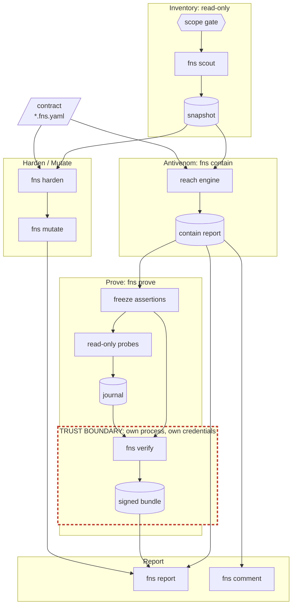
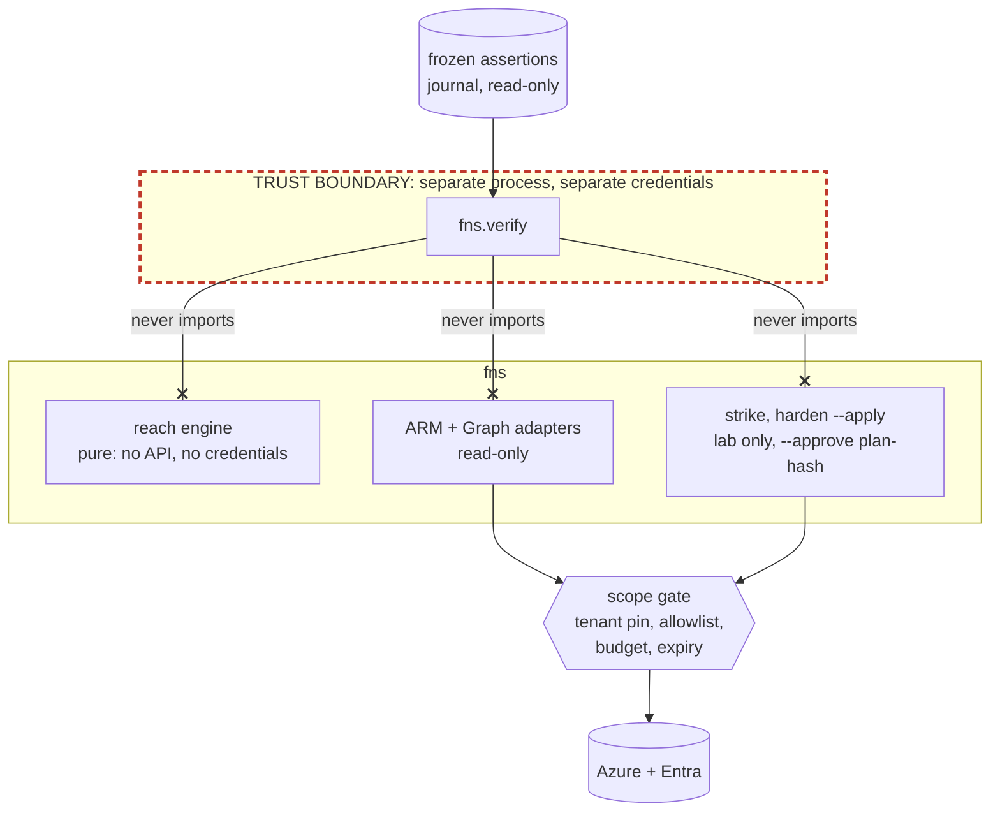

# Guide

The detail behind the [README](../README.md): the full demo from a checkout, how
the pieces fit, what each fixture proves, the MCP server, the lab, and
development. Design: `docs/PLAN.md`. Trust boundaries: `docs/ARCHITECTURE.md`.

## Demo from a checkout (no tenant)

Requires [uv](https://docs.astral.sh/uv/) and a clone of this repository. The
demo commands replay `fixtures/lab-run-3`, the live lab run recorded in M3 and
sanitized. Its scout ran as `sp-fns-scout`, and its probes ran as
`sp-billing-agent`. `fixtures/lab-run-1` and `fixtures/lab-run-2` are the M1 and
M2 runs. Every line they print starts with
`FIXTURE`, and none of them makes a network call.

```
uv sync
uv run fns demo contain      # 1. What can a compromised billing agent reach?
uv run fns demo prove        # 2. Freeze assertions, replay probes, verify in a separate process
uv run fns demo mutate       # 3. Harden the lab in the model, then try to break the contract
uv run fns demo report       # 4. One HTML page: .fns/report.FIXTURE.html
```

**1. Contain.** The seeded lab contract fails on purpose (exit 1): 11 critical
findings. The agent's owner rights on another application lead to directory-wide
role assignment (output shortened):

```
FIXTURE FAIL directory:tenant roleAssignments/write  modeled / modeled-only
FIXTURE   1. [assume-compromised] assume sp-billing-agent is compromised
FIXTURE   2. [snapshot] sp-billing-agent holds the Graph permission Application.ReadWrite.OwnedBy
FIXTURE   3. [owner-adds-credential] sp-billing-agent owns app-escalation-target; with
FIXTURE      Application.ReadWrite.OwnedBy it adds a credential and signs in as app-escalation-target
FIXTURE   4. [snapshot] app-escalation-target holds the Graph permission AppRoleAssignment.ReadWrite.All
FIXTURE   5. [approle-self-grant] ... grants app-escalation-target RoleManagement.ReadWrite.Directory
FIXTURE   6. [graph-permission] RoleManagement.ReadWrite.Directory allows roleAssignments/write ...
```

**2. Prove.** Assertions are frozen and hashed before any probe runs. The verifier
then runs as a separate process that reads only those assertions and the journal.
It judges each path and signs an in-toto statement in a DSSE envelope. The demo
uses an offline key, and the output labels it `TEST SIGNATURE`. Run
`uv run fns verify .fns/runs/<run id>` to check a run; tampering exits 5.

**3. Harden and mutate.** `fns harden` searches the grants it can map in
`lab/*.tf`, smallest set first, for the smallest removal that takes the lab to 0
critical findings in the model while keeping legitimate use: drop the agent's
`Application.ReadWrite.OwnedBy` and its resource-group `Contributor`. It writes a
diff and a plan hash; it never applies anything. Mutation
testing then puts back one dangerous grant at a time. **Mutation testing found a
gap in our own contract:** the first run caught 5 of 8, because contract version 1
could not name one application. Version 2 can, and the seeded contract now guards
the verifier and scout applications and the invoice account's keys. It catches 6
of 8. The two survivors make the agent an owner of `id-verifier` or `sp-fns-scout`.
In the hardened lab the agent holds no Graph permission that can use an ownership,
so the model gains no reach, and the output says exactly that
(`docs/FINDINGS.md`). They are accepted as explained survivors: no contract line
can kill them, and the Graph grant that would make the ownership usable is
already caught.

**4. Report.** Coverage comes first, then the reach graph, findings and paths, the
proof bundle and the mutation results. It is one self-contained HTML file with
Cytoscape.js embedded (MIT, `src/fns/report/vendor/`), so it opens offline and
makes no network request.

Other commands: `fns harden`, `fns record` (turns logs into `must_still_do`),
`fns detections check|export` (KQL rules as code), `fns comment`, and
`fns scope check`. Run `uv run fns --help` for the full list.

## How the pieces fit

**Main flow.** Rectangles are steps, cylinders are the files they write.



**Trust boundaries.** Only the scope gate talks to Azure. Only two commands can
write, and only to the lab. The verifier shares no code with what it checks.



Two import contracts enforce the boundaries. `fns.verify` imports nothing from
the reach engine, probes, prover, harden, adapters or scope. The reach engine
cannot import adapters, credentials, the journal, strike or harden.

## Real vs. fixture

| What | Evidence so far |
| --- | --- |
| Scout (RBAC, Graph, owners, roles) | **Live** on the lab tenant, 2026-11-26, three times. Recorded and sanitized as `fixtures/lab-run-1` (M1), `fixtures/lab-run-2` (M2) and `fixtures/lab-run-3` (M3). The M3 digest is identical to M2's. |
| Key Vault and storage settings collectors (M2 C1) | **Live** in the M2 run, 2026-11-26: one vault and two storage accounts, `complete`. |
| PIM eligibility collector | **Live** in the M2 run, as `not-applicable` with evidence: the lab tenant is Entra ID Free (0 SKUs), and Graph and ARM both answered `400 AadPremiumLicenseRequired`. The `collected` path, in a tenant with P2, is mocked tests only. |
| Reach engine and contracts (`fns contain`) | **Live** on the M2 snapshot, signed in as the read-only scout: 11 critical reachable, 2 inconclusive, exit 1, the same as the fixture replay. Results are rung 1 (modeled). The replay of `fixtures/lab-run-2` with its contract is a committed regression test. |
| Prove: probe results | **Live** on the lab, 2026-11-26, signed in as `sp-billing-agent`. There were 14 `GET` and `HEAD` requests through the scope gate, all allowed by it. Result: passed 1 (invoices `blob/read`, observed), critical reachable 11, inconclusive 1, exit 1. The Key Vault and payroll reads were denied when probed, but escalation paths remain, so they still fail. The results are recorded and sanitized as `fixtures/lab-run-3/probes.json`, and its replay is the M3 regression test, with the same verdicts. The `probes.json` in lab-run-1 and lab-run-2 stays hand-written. |
| Signing | The live run is signed with the offline test key, labelled `TEST`. In CI, `prove-sign` signs the lab-run-3 replay with Sigstore keyless signing: **production** (public Rekor log) on every push to `main`, staging on pull requests. It signs a FIXTURE replay, not a live run. See [Verify a signed result](../README.md#verify-a-signed-result). |
| Harden, mutate | Model only, on the recorded snapshot and `lab/*.tf`. Nothing applied. `fns mutate --harden` on the live M2 snapshot scored 6/8, with the two accepted app-owner survivors. |
| Record mode | Hand-written sample logs. |
| Detections | Structural lint only; never deployed. |
| GitHub Action | Runs on this repo's PRs against `fixtures/lab-run-1` and the bundled set; no Azure login. Not yet used from another repository ([ACTION](ACTION.md)). |

Anything replayed from a fixture prints `FIXTURE`, and reports built from one say
so in the title.

## MCP server (read-only)

`fns mcp serve` is a [Model Context Protocol](https://modelcontextprotocol.io)
server on stdio. With it, an assistant can list and read fixture sets, read
contain reports, and run `fns contain` on a fixture. It has no write tool and
makes no network call. Its five tools:

- `list_fixtures`, `read_fixture_file`: the bundled sets, and a checkout's
  `fixtures/` with `--fixtures`. Files come from a fixed list, which never
  includes the sanitizer's ID map or the recorded exchanges.
- `contain_fixture`: replays a set and returns the `ContainReport` (FIXTURE).
- `list_reports`, `read_report`: report files from `--reports`. These are
  FIXTURE only, unless you pass `--include-live`.

An MCP client configuration, for example:

```json
{
  "mcpServers": {
    "fang-and-scale": {
      "command": "fns",
      "args": ["mcp", "serve", "--fixtures", "fixtures", "--reports", ".fns/reports"]
    }
  }
}
```

LIVE reports hold real tenant names and IDs. Pass `--include-live` only to a
client you would show them to. Strings from a tenant are data, never
instructions, and every tool description says so.

## Lab and live runs

`lab/` is a Terraform lab (azurerm + azuread) for a **dedicated lab tenant**. It
contains:

- an over-privileged `sp-billing-agent`;
- a Key Vault and storage holding synthetic data;
- a privileged `app-escalation-target` owned by the agent;
- a read-only `id-verifier` and a read-only `sp-fns-scout`.

`uv run poe lab-up` applies it and writes `scope.lab.yaml` (gitignored).
`uv run poe lab-down` destroys it. Terraform refuses to run if the signed-in tenant
differs from `tenant_id`.

```
uv run poe scout                                       # live, read-only
uv run fns scout --record fixtures/my-run            # also save a sanitized fixture set
uv run fns demo scout --fixture fixtures/my-run      # replay it later, no tenant needed
```

### Scout permissions

The scout identity (`sp-fns-scout`) gets exactly these grants, and none of them
can write:

| Grant | Scope | Used for |
| --- | --- | --- |
| Azure RBAC **Reader** | lab subscription | role assignments and definitions, deny assignments, resources, and Key Vault and storage settings (access policies, permission model, shared-key access) |
| Graph **Application.Read.All** (application) | tenant | service principals, applications, their owners, app role assignments |
| Graph **RoleManagement.Read.Directory** (application) | tenant | directory role definitions, assignments and PIM eligibility schedules |
| Graph **LicenseAssignment.Read.All** (application) | tenant | `/subscribedSkus`: the evidence that a tenant without PIM has no PIM |
| Graph **Directory.Read.All** (application) | tenant | `memberOf`, and resolving owners and members that are users or groups |

- **Reader** is `*/read` only: no actions (so no `listKeys`) and no data plane.
  It also covers Azure resource PIM eligibility (`roleEligibilitySchedules/read`).
- The three Graph read permissions are the least-privileged ones documented for
  those endpoints.
- **PIM eligibility.** When the scope allows it, the scout lists eligible role
  assignments. If the tenant has no PIM licence, it records `pim-eligibility` as
  *not applicable*, with the responses as evidence. It never infers this from a
  failure alone. Otherwise every finding stays inconclusive on PIM.
- **Directory.Read.All** is the broadest grant here. The first live run showed the
  set is sufficient. Whether it can be dropped is the next live test
  (`docs/runbooks/m1-live-run.md`, `docs/FINDINGS.md`).

The scope manifest narrows this further. It allows only the read operations listed
in `scope.lab.yaml`, only inside the lab subscription and resource group, within a
call and time budget, and only until `expires_at`.

## Development

Works on Windows, macOS and Linux. CI runs on ubuntu and windows.

```
uv run poe setup      # uv sync --all-groups --all-extras, then pre-commit hooks
uv run poe check      # ruff + mypy --strict + import boundaries + schema drift + pytest
uv run poe lab-check  # terraform fmt -check + validate (no credentials needed)
uv run poe schema     # regenerate the committed JSON Schemas in schemas/
```

Sync with `--all-extras` as well as `--all-groups` (`poe setup` does): `sigstore`
is an extra, because `fns prove --sign sigstore` is part of the installed tool,
and a plain `uv sync --all-groups` uninstalls it.
